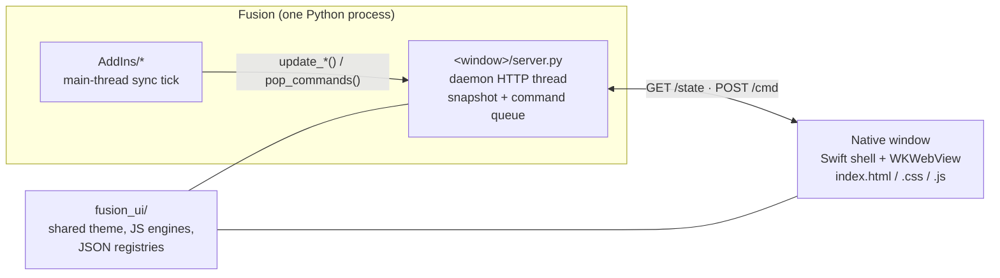

# Fusion 360 Tools

**A custom interface for Autodesk Fusion: ~60 add-ins plus a family of companion windows that replace Fusion's own browser, timeline, parameter table, shortcut editor and feature dialogs.**

I model architecture and furniture in Fusion and wanted it to feel faster and more direct: fewer dialogs, everything on a key, the model tree and timeline always visible and editable. This repository is the result: Python add-ins running inside Fusion, and native macOS windows (Swift + WKWebView, HTML/CSS/JS) that talk to them over local HTTP.

---

## Highlights

| | What it does |
|---|---|
| **Browser** | A replacement component browser docked beside the viewport: nested folders for bodies and sketches, rename in place, drag to file, visibility snapshots per level, Go Up / Go Down / Go to Top navigation, and a "peek" mode that previews a component without activating it. |
| **Vertical timeline** | The design history as a vertical list with operation icons, errors, inline rename / edit / suppress and nested, window-only groups. |
| **Parameters** | A parameter editor with automatic naming: typed numbers become named parameters, and names are generated from what the dimension measures (`param_naming.py/.js`). |
| **Value window + command search** | One small dialog replaces Fusion's own for Extrude, Mirror, Combine, Scale, Rectangular Pattern, Sketch Fillet and sketch dimensions; it also hosts a fuzzy command palette. Dictated values (`"half the depth plus ten"`) are turned into expressions over the document's real parameter names (`spoken_expr.js`). |
| **Shortcuts** | A searchable keyboard-shortcut editor for every Fusion command, writing Fusion's own keymap. |
| **Click Actions** | What a viewport click, two- or three-finger tap does is data (`fusion_ui/clicks.json`), keyed by gesture, held modifiers and what was clicked (body, sketch, component, empty space…). |
| **Section Sketch** | Draw a profile against the model and get dimensions to the component bounds automatically; references are rebuilt from sketches on replay. |
| **Smart Sketch / Smart Dimension / Sketch Directions** | Say where the sketch goes in words; supply the datum for the dimension you are already making; make a chain of curves run one way. |
| **Housekeeping add-ins** | Auto-naming of bodies and features, bounds-aware new components, isolate / visibility cycling, minimal UI, maximised viewport, version list without Fusion's dialogs, and a dev probe that runs code inside Fusion from outside it. |

## Architecture



The Fusion API is only ever touched on Fusion's main thread; the HTTP thread only reads a snapshot and queues commands. Every window shares one plumbing layer (`fusion_ui/webwin.py`) and one look (`fusion_ui/theme.css`), so a fix reaches all of them. More detail in **[ARCHITECTURE.md](ARCHITECTURE.md)**.

## Repository layout

```
AddIns/            The Fusion add-ins (one folder each) + shared engines (Feature Panel.py, Section.py, Groups.py…)
fusion_ui/         Shared layer: theme, list/menu/keys/search JS, naming + geometry helpers, registries, tests
fusion_browser/    Browser window            fusion_timeline/   Vertical timeline
fusion_params/     Parameter editor          fusion_value/      Value dialog + command search
fusion_shortcuts/  Shortcut editor           fusion_dock/       Left-edge dock hosting Browser / Timeline
fusion_tests/      Offline tests (Fusion API stubbed)
native/            Small Objective-C helpers (window glow, busy detection, palette hiding) + app-bundle build script
```

## Tests

The pure logic is tested offline. Python tests stub the `adsk` module; the window JavaScript is tested headlessly by concatenating the shared engines, the page's own `index.js` and a file of assertions, then running them under macOS's built-in JavaScriptCore (`jsc`). See `fusion_ui/jsc_harness.py` and each window's `test/` folder.

## Notes

This is a working snapshot of a personal setup, not a packaged product. Paths point at the folders it was developed in (e.g. `~/Code/Scripts/fusion_ui/`), and some features expect companion tools from the same system, such as the trackpad navigation in [trackpad-gestures](https://github.com/JoshCallis/Magic-Trackpad-Customisation). Requires Autodesk Fusion on macOS.
